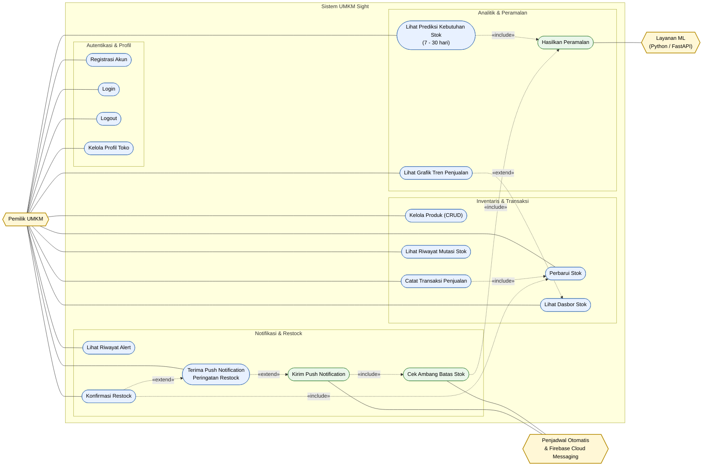
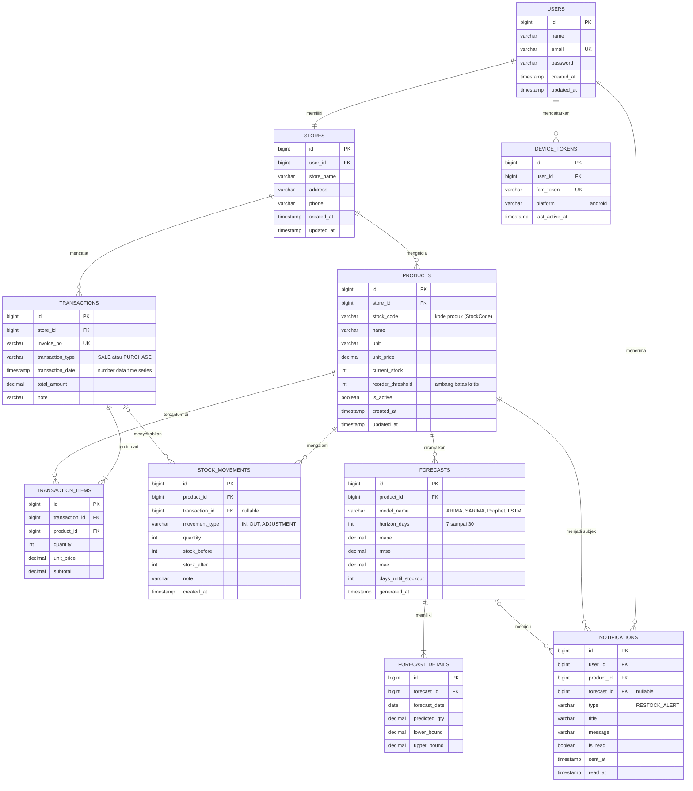
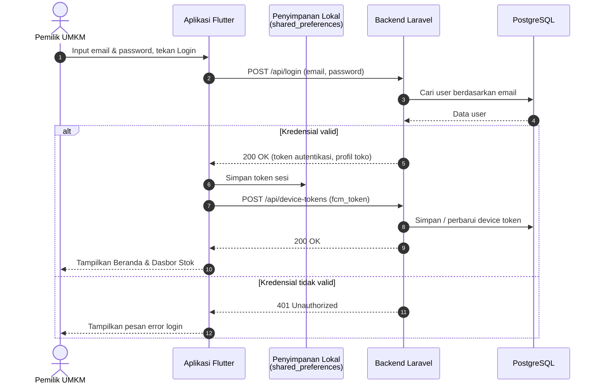
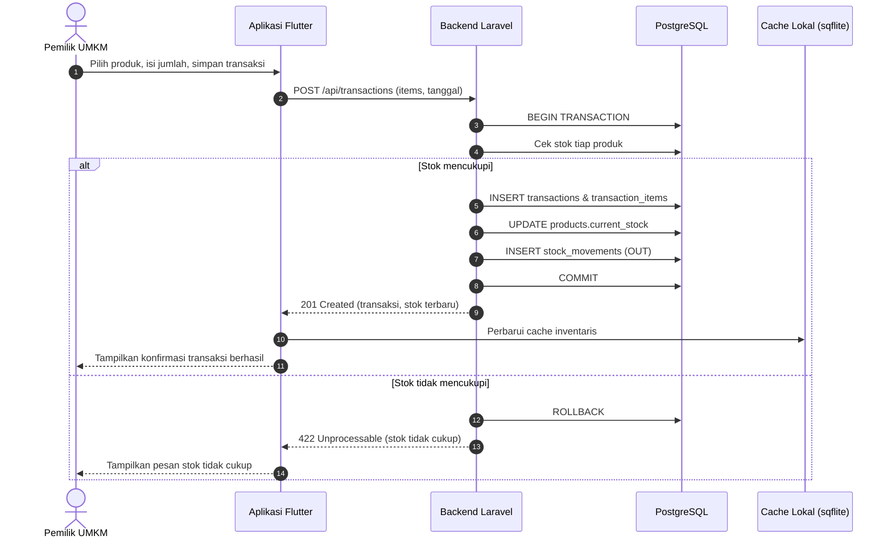
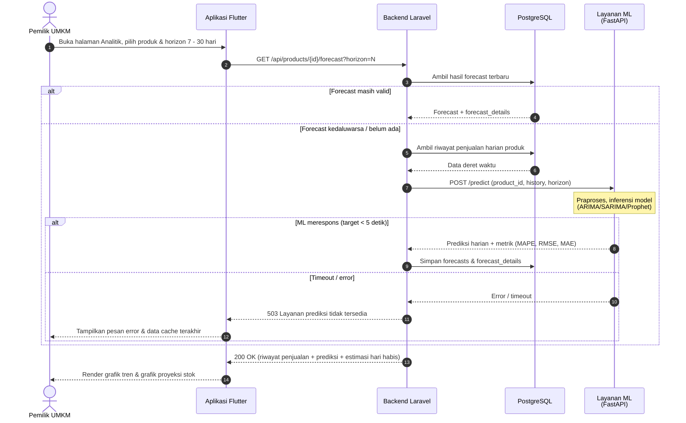
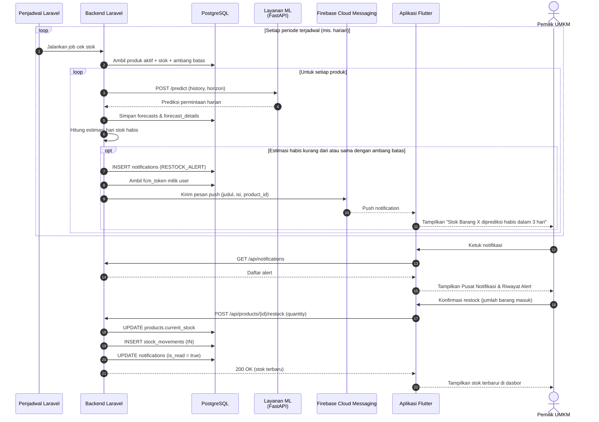
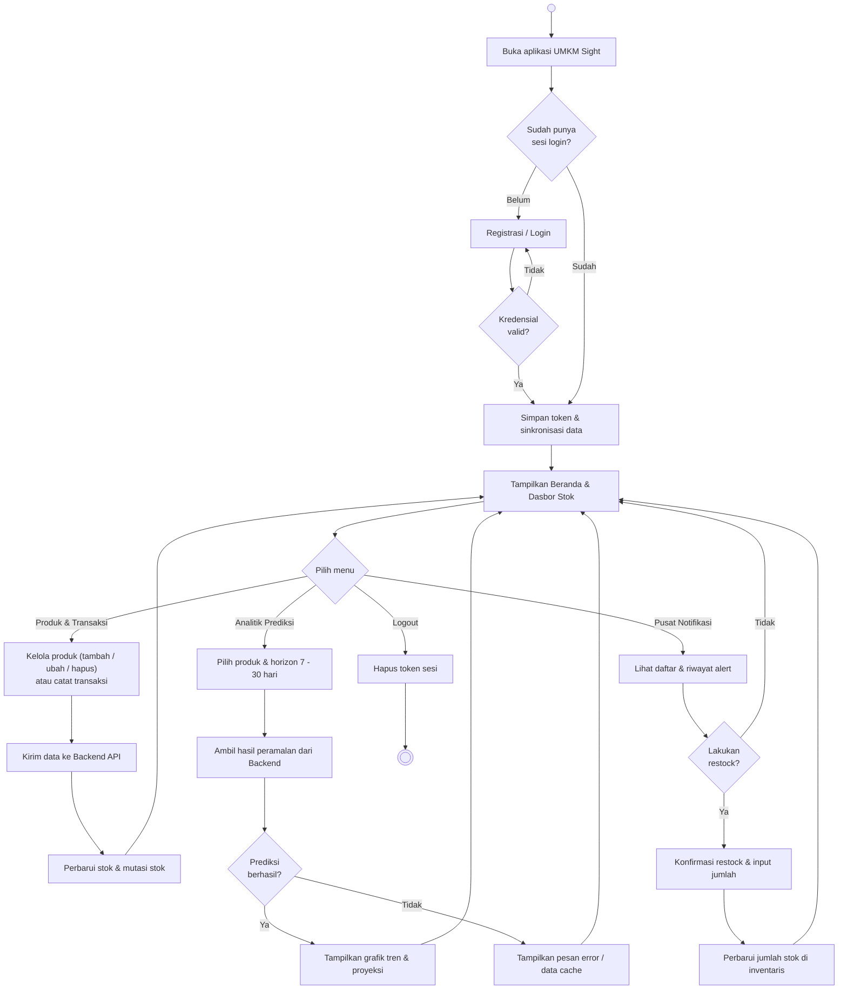
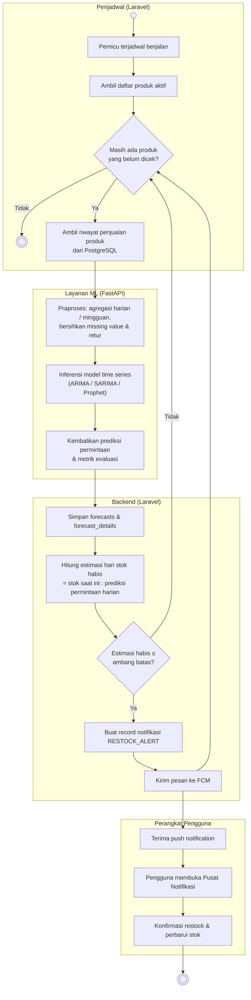
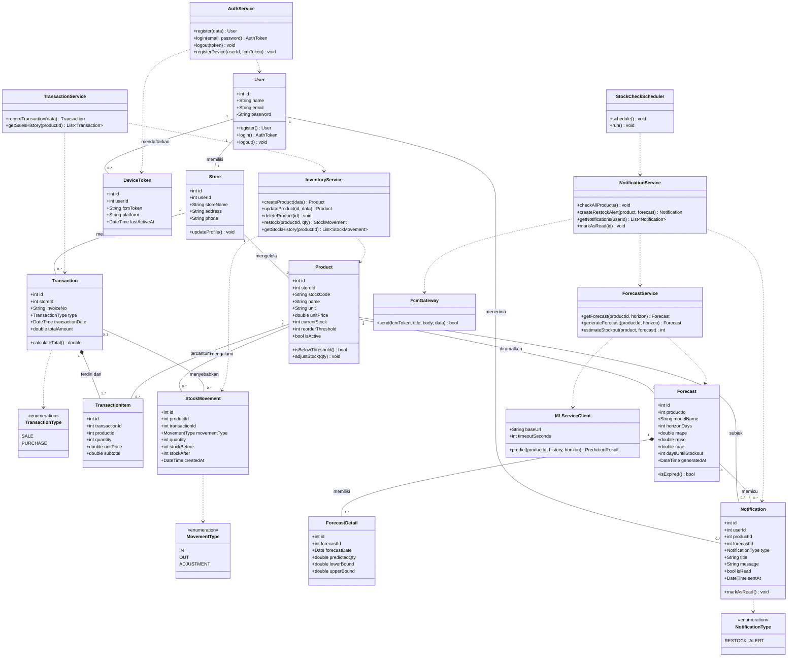

# UMKM Sight
1. Use Case Diagram
2. ERD
3. Sequence Diagram (4 skenario)
4. Activity Diagram (2 alur)
5. Class Diagram

> Catatan: Mermaid tidak punya tipe "use case" dan "activity" bawaan, jadi keduanya dibuat dengan `flowchart` yang dibentuk menyerupai notasi UML.

---

## 1. Use Case Diagram

Aktor: **Pemilik UMKM** (primer), **Layanan ML (FastAPI)** dan **Penjadwal & FCM** (sekunder/sistem).

**Keterangan relasi**
- Semua use case milik Pemilik UMKM (kecuali Registrasi & Login) mensyaratkan Login terlebih dahulu.
- `UC13 «extend» UC17`: notifikasi push hanya diterima jika sistem mengirimkannya (stok diprediksi menipis).
- `UC15 «extend» UC13`: konfirmasi restock opsional, dilakukan setelah pengguna menerima notifikasi.

---

## 2. ERD (Entity Relationship Diagram)

Rancangan basis data PostgreSQL. Satu akun = satu toko (sesuai batasan "single outlet" pada proposal).

---

## 3. Sequence Diagram

### 3.1 Login & Registrasi Token Perangkat

### 3.2 Pencatatan Transaksi Penjualan

### 3.3 Melihat Analitik & Prediksi Kebutuhan Stok

### 3.4 Automated Push Notification & Konfirmasi Restock

---

## 4. Activity Diagram

### 4.1 Alur Penggunaan Utama (Pemilik UMKM)

### 4.2 Alur Peramalan & Automated Push Notification (Sistem)

---

## 5. Class Diagram

Gabungan model domain (sesuai ERD) dan kelas layanan pada backend Laravel + integrasi ML.

---

## Asumsi yang dipakai (silakan koreksi)

1. Aktor utama hanya **Pemilik UMKM**; tidak ada admin (proposal tidak menyebut peran admin).
2. Satu akun = satu toko → relasi `USERS 1:1 STORES`.
3. Transaksi punya tipe `SALE` (keluar) dan `PURCHASE` (masuk/restock); riwayat mutasi dicatat di `STOCK_MOVEMENTS`.
4. Hasil peramalan disimpan (`FORECASTS` + `FORECAST_DETAILS`) agar tidak dihitung ulang tiap dibuka dan bisa dipakai sebagai dasar notifikasi.
5. Notifikasi dikirim lewat Firebase Cloud Messaging (FCM) oleh scheduler Laravel; proposal hanya menyebut "push notification", belum menyebut layanan spesifiknya.
6. Autentikasi memakai token (mis. Laravel Sanctum); proposal hanya menyebut "token autentikasi".
